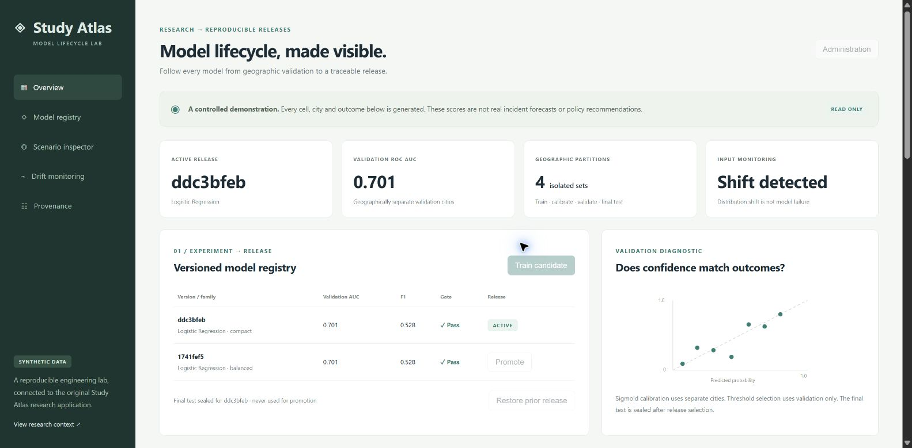
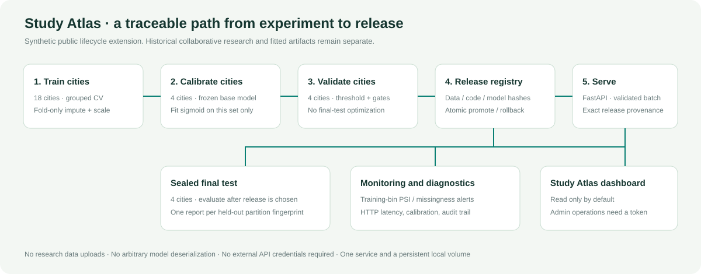
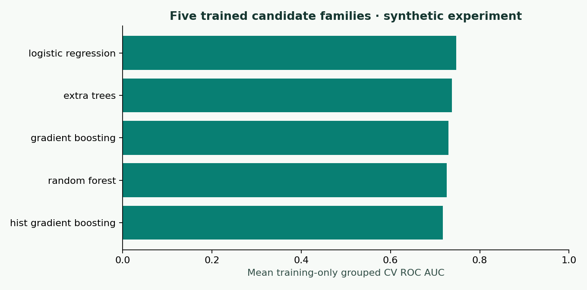
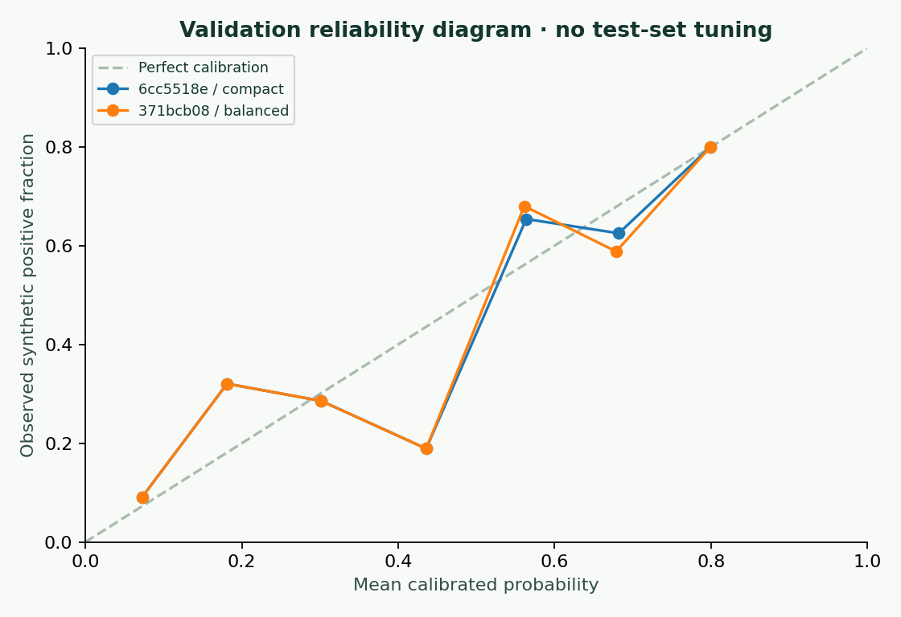
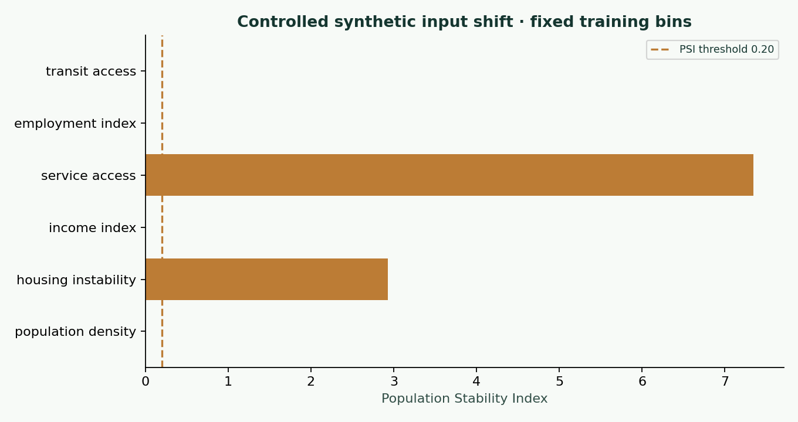
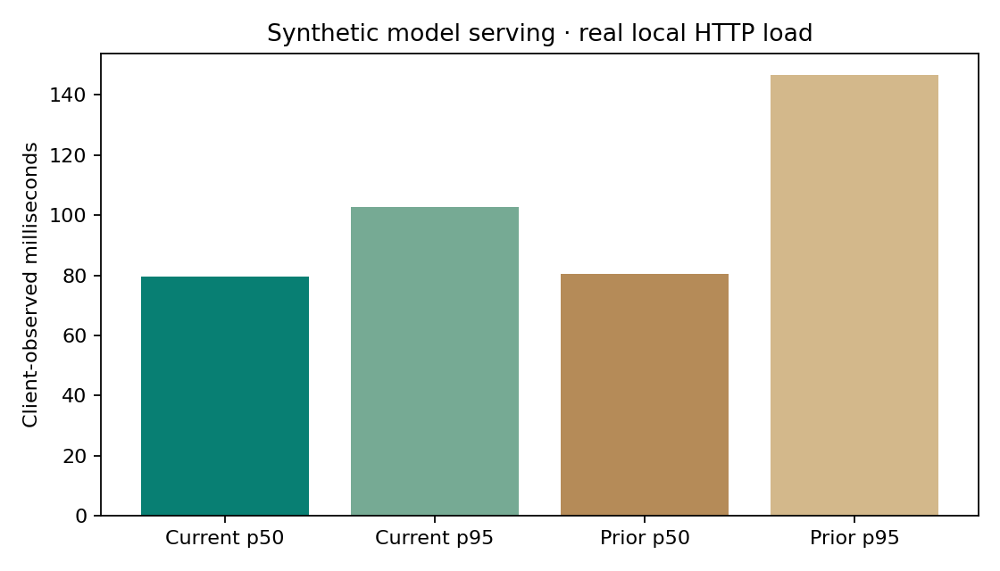

# Study Atlas · Model Lifecycle & Serving

**A complete synthetic model-release lab extending the original Study Atlas research application.**

Train five candidate families without geographic leakage. Calibrate and select thresholds on separate cities. Promote a gated release, serve traceable predictions, detect a controlled input shift and restore a prior model under real HTTP load.

[](https://github.com/Vinay-Vikkranth/study-atlas-model-lifecycle/actions/workflows/ci.yml)



*Actual local browser demonstration. The screenshot shows an earlier generated release ID; the final measured artifact IDs and scores are recorded in the evidence files below.*



## Why this exists

The [original Study Atlas](https://github.com/Vinay-Vikkranth/gun-violence-geospatial-ml) already provided FastAPI model serving, grid/city inspection, scenarios, five trained research classifiers and artifact fingerprints. The missing engineering proof was a **new leakage-safe experiment and a repeatable model lifecycle**. This project adds that proof without changing historical research files, exposing restricted inputs or reusing research scores as demo performance.

The public dataset is fully generated: **30 fictional city groups, 2,160 rows and six normalized features**. Its outcomes and diagram coordinates are synthetic. This is not a real incident forecast, causal intervention, policy recommendation or law enforcement deployment. See the [model card](docs/MODEL_CARD.md) for precise scope and limitations.

## Run it

Python 3.12, no external API key and no paid service required.

```powershell
python -m venv .venv
.venv\Scripts\python -m pip install -r requirements.txt
.venv\Scripts\python scripts/start.py
```

Open **http://127.0.0.1:8740**. On macOS/Linux substitute `.venv/bin/python`. First startup generates the dataset, trains two versioned releases, evaluates the fixed gates, seals a single final-test report and records reference/shifted monitoring batches. Restarts retain the registry.

The dashboard includes the active version, validation scores, calibration diagram, partition sizes, model promotion controls, a scenario inspector, synthetic cell view, drift monitor and audit trail. Administration is disabled by default. Configure a local `ATLAS_ADMIN_TOKEN` before startup to use train, promote, rollback or drift simulation controls; there is no public default password. Read-only prediction and provenance routes work without that token.

## What is implemented

| Layer | Actual behavior |
|---|---|
| Data provenance | Seeded generator, schema manifest, CSV SHA256, frozen bytes during training, geography separation checks |
| Training | Five executed candidate families; grouped CV fits imputation/scaling inside every fold; deterministic seeds and single-thread native math |
| Calibration | Frozen base model; sigmoid fitted only on four separate calibration cities |
| Selection | Family chosen from train-only CV; threshold and fixed acceptance gates use four validation cities |
| Final test | Four untouched cities scored after release selection; one immutable report per held-out partition fingerprint |
| Registry | Model/data/config/training-code hashes, validated trusted artifacts, transactional pointer changes, append-only application events |
| Release control | Token-protected promote/rollback, validation gate rechecks, stale-pointer rejection, integrity verification, no self-promotion history corruption |
| Serving | Batched FastAPI input validation, probabilities/thresholds, exact served model and artifact hashes, grid/city compatibility concepts |
| Monitoring | Fixed training-bin PSI and missingness alerts; normal/shifted synthetic batches, request IDs, structured logs, metrics |
| Evidence | Executed regression tests, measured loopback HTTP p50/p95, version switch and exact rollback/recovery verification, generated plots |
| Delivery | Non-root container, persistent local volume, health/readiness endpoints, GitHub CI and a read-only Render deployment recipe |

### Geographic boundaries

| Partition | City groups | Rows | Allowed use |
|---|---:|---:|---|
| Train | 18 | 1,296 | Fold-contained preprocessing, grouped CV, family selection and final base-model fit |
| Calibration | 4 | 288 | Fit the sigmoid while the base model stays frozen |
| Validation | 4 | 288 | Select threshold and assess declared release gates |
| Final test | 4 | 288 | One sealed report after the release has already been selected |

Candidate families are logistic regression, random forest, gradient boosting, histogram gradient boosting and ExtraTrees. These are **five newly trained synthetic candidates**, not claims that the original XGBoost/LightGBM research artifacts were redistributed or revalidated.

## Measured evidence

| Executed local check | Result |
|---|---|
| Regression suite | 32 tests passed in 8.471 seconds on Windows / Python 3.12 |
| Real HTTP load | 80 requests per release, four concurrent clients, zero errors across 160 predictions |
| Current release latency | p50 79.64 ms; p95 102.74 ms, client observed on loopback |
| Prior release latency | p50 80.56 ms; p95 146.54 ms, same local run |
| Release recovery | Version changed, prior model restored, original release reactivated with identical prediction |
| Failure handling | Malformed request 422; unauthenticated mutation 401; corrupted model readiness 503 |
| Controlled drift | Reference batch did not alert; intentionally shifted batch alerted |









The exact metrics, hashes, partitions and validation/final-test reports are in [experiment.json](docs/evidence/experiment.json). The bounded real-HTTP load run, per-version p50/p95, error counts, malformed-input check, unauthorized-write check and prediction recovery assertion are in [benchmark.json](docs/evidence/benchmark.json).

Local latency includes connection setup, schema validation, artifact hash verification/loading and inference. It is not cloud latency, a production SLO achievement or a comparison with the historical research app. Reference and shifted drift batches are simulations; input shift alone does not prove model-quality failure.

## Verify and reproduce

```text
python -m unittest discover -s tests -v
python -m atlas_lifecycle.cli demo
python -m atlas_lifecycle.cli report
python scripts/benchmark.py --requests 80 --concurrency 4
```

The tests deliberately poison held-out features and labels, recompute fold medians, attempt invalid gates, tamper artifacts and paths, race active-pointer changes, restart the registry, reuse a sealed test set after changing training rows, reject unauthorized mutations and verify exact rollback predictions. A presence-only Dockerfile check is not counted as container execution; the GitHub workflow builds and smoke-tests the container when it runs successfully.

The dated local execution summary is in [verification.json](docs/evidence/verification.json). CI runs regenerate evidence with their own timings; exact latencies are hardware and load dependent.

## API examples

```bash
curl http://127.0.0.1:8740/api/overview
curl http://127.0.0.1:8740/api/hexes?limit=10
curl -X POST http://127.0.0.1:8740/api/predict \
  -H 'Content-Type: application/json' \
  -d '{"records":[{"population_density":0.4,"housing_instability":0.7,"income_index":0.5,"service_access":0.3,"employment_index":0.5,"transit_access":0.6}]}'
```

Interactive schema documentation is at `/docs`; service counters are at `/metrics`. Model upload and arbitrary deserialization endpoints do not exist. The registry volume remains a trusted local boundary.

## Project layout

```text
atlas_lifecycle/       generator, grouped training, calibration, registry, API, drift, CLI
frontend/             same-origin lifecycle dashboard and scenario inspector
tests/                leakage, integrity, release, recovery and HTTP regression cases
scripts/              one-command startup and isolated real HTTP benchmark
docs/                 model card, architecture, operations, provenance and measured evidence
.github/workflows/    native regression, artifact upload and Docker smoke test
runtime/              generated local state only; ignored by Git
```

## Delivery and research lineage

`docker compose up --build` runs the app with a persistent named volume and administration disabled unless configured. `render.yaml` is a deployment recipe, **not evidence of a live cloud deployment**. Its free ephemeral filesystem cannot establish durable cloud state. A paid disk, account setup or production deployment needs separate approval.

Read [operations and rollback instructions](docs/OPERATIONS.md), the [model card](docs/MODEL_CARD.md), [research lineage](docs/RESEARCH_LINEAGE.md) and [attribution notice](NOTICE.md). Original collaborative research, restricted datasets, fitted research weights and unpublished manuscripts are not bundled or relicensed. The implementation and documentation were prepared with AI assistance; a public repository is not proof of independent implementation or customer adoption.
